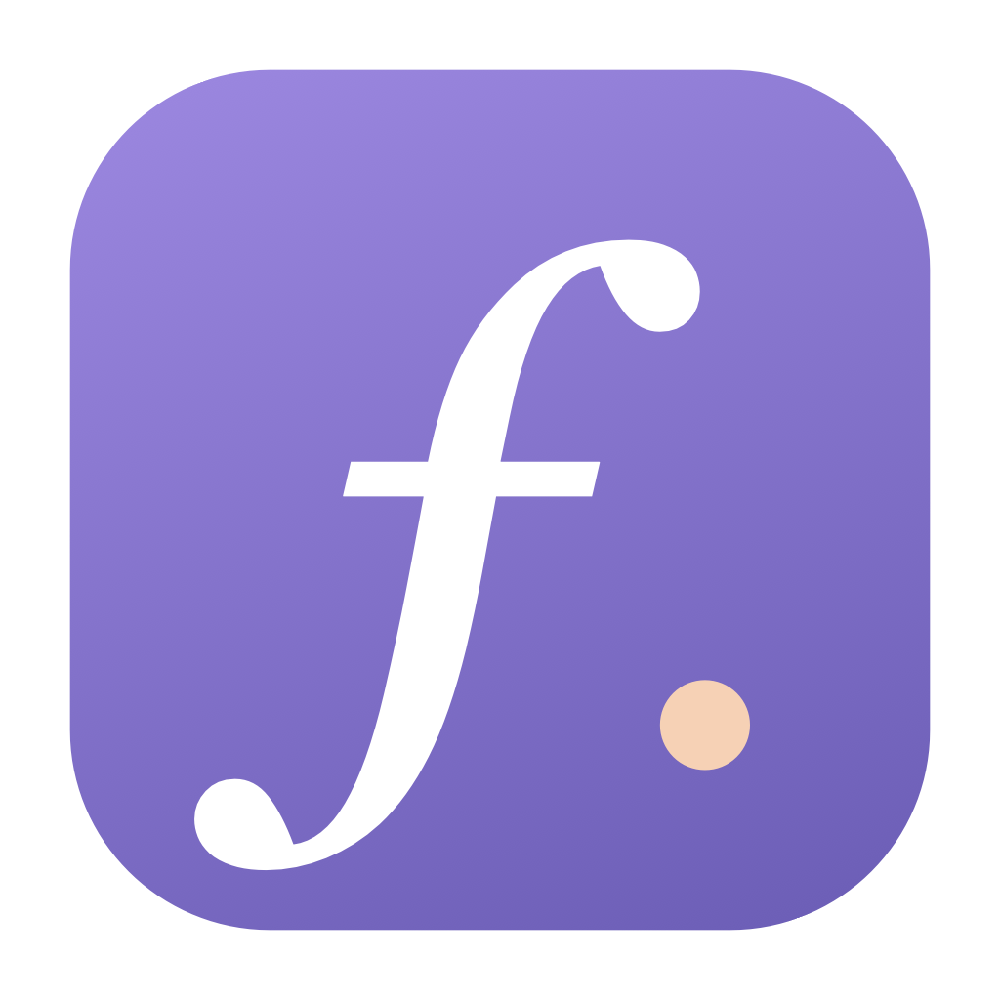
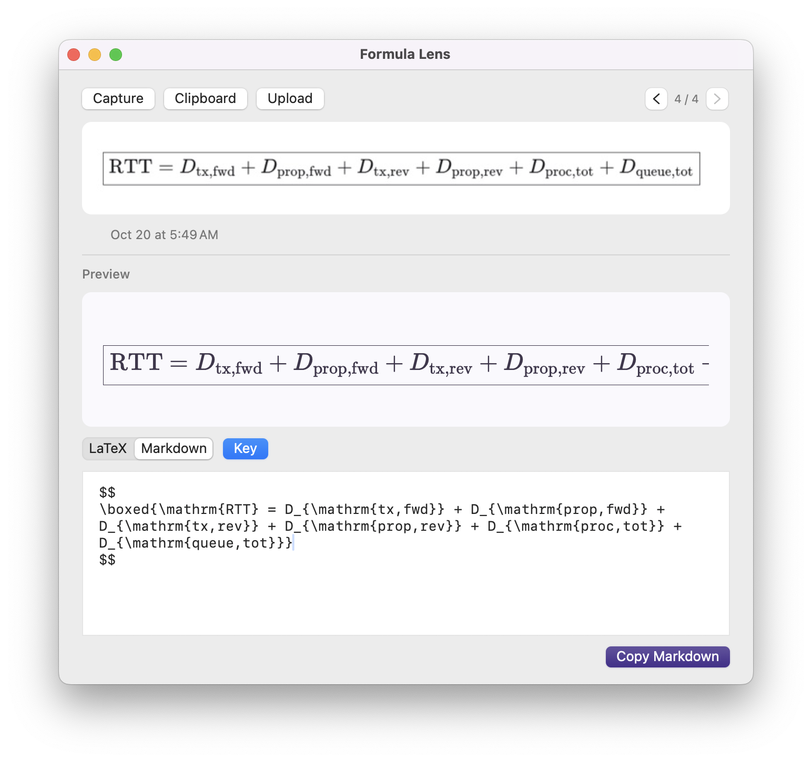

# Formula Lens

A lightweight macOS menu bar app that turns formula screenshots into LaTeX and Markdown using your local Claude Code installation.

> If Claude Code is already installed and configured in your terminal, just install and open Formula Lens -- **no additional app configuration is needed**. 🌟

## Features

- Capture a formula with a customizable global shortcut.
- Recognize images from your clipboard or upload a file.
- Preview and edit LaTeX and Markdown before copying.
- Copy results with one click; the result window closes automatically.
- Browse your latest 30 results with saved edits and thumbnails.
- Remember your preferred window size and position.
- Left-click the menu bar **f** to open the window; right-click for options.

## Requirements

An Apple silicon Mac running macOS 13 or later, a working and signed-in Claude Code CLI, and an internet connection. Screen Recording permission is required for screenshot capture.

Images are sent to the model service configured in Claude Code and use the associated account allowance.
